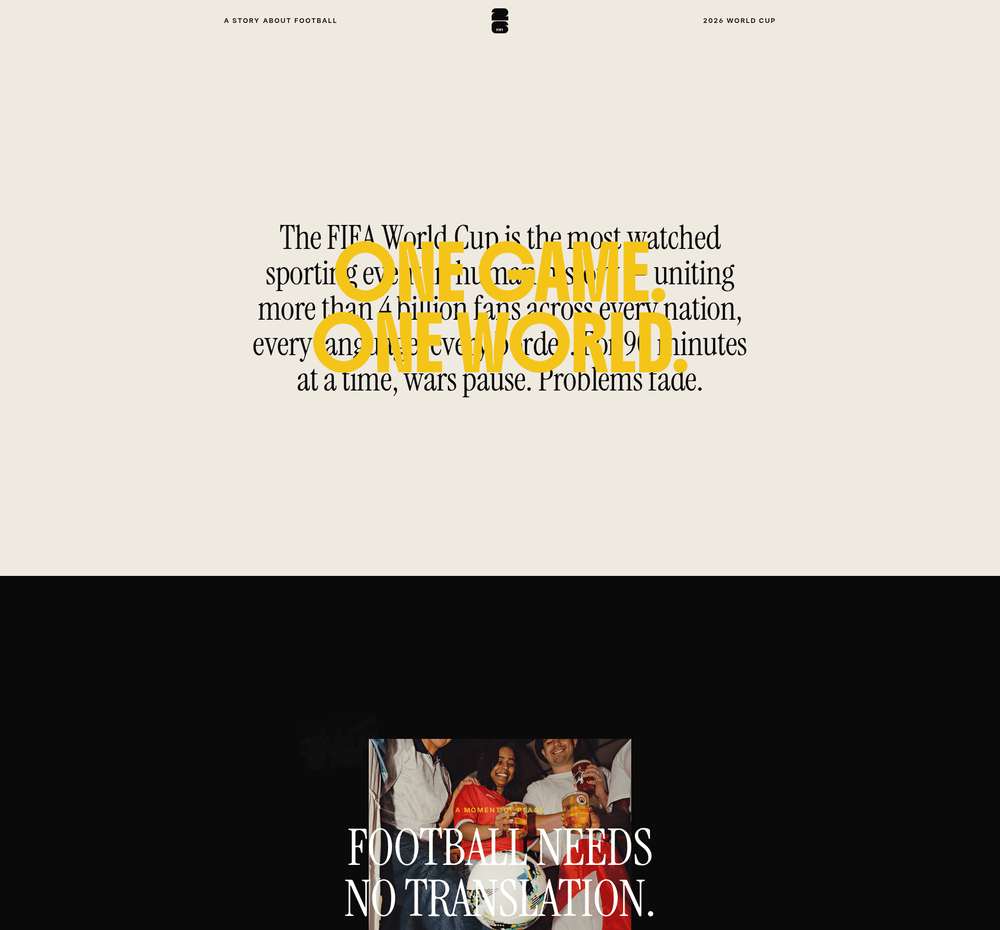
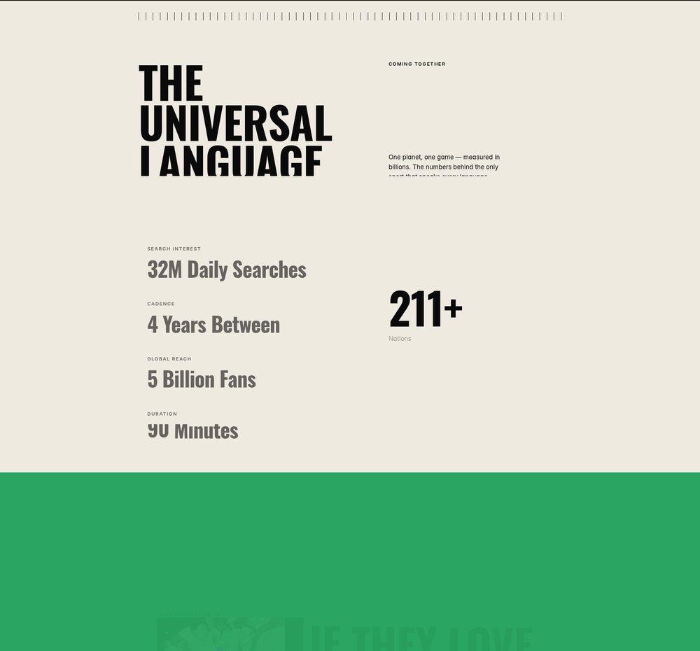
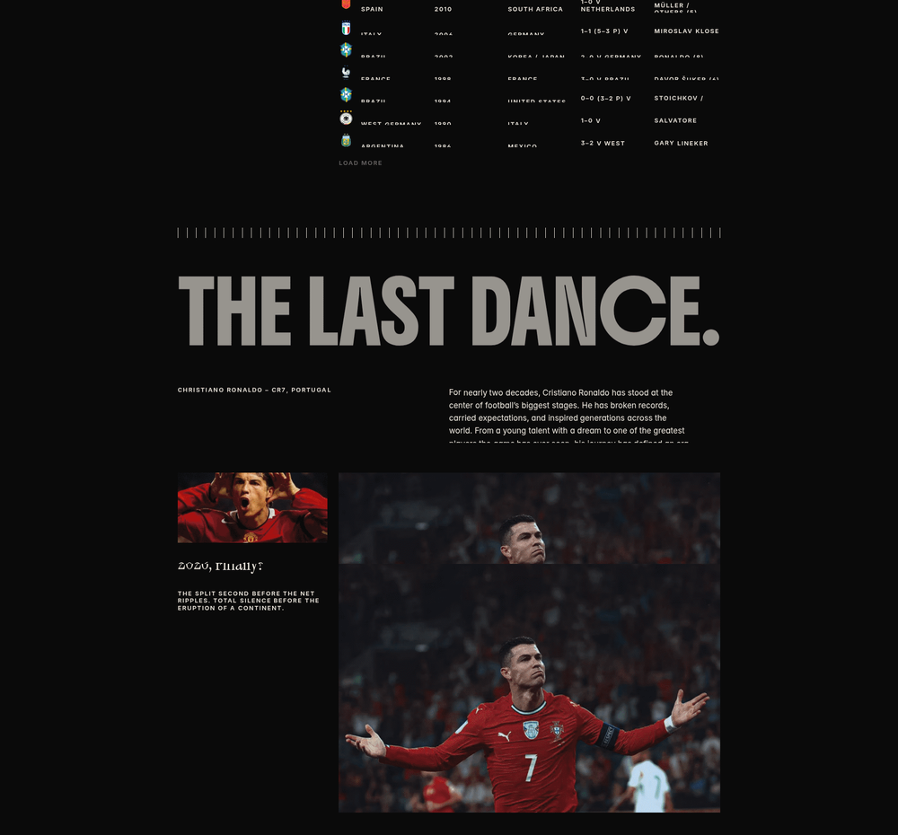

# DESIGN.md: United — Football & the 2026 World Cup

> **Reference only.** This is an extracted design system from a third-party site, captured so
> agents can build *in this style*. It confers no rights to United's photography, trophy art,
> copy, or wordmark. Every image on that site is licensed press photography — none of it is
> reusable here. Tokens and patterns transfer; assets do not.
>
> **Not applied to Frontier Football.** Frontier's own signed-off system is
> `src/styles/tokens.css` + `docs/HOUSE-RULES.md` and remains authoritative. See
> [Appendix: fit against Frontier](#appendix-fit-against-frontier) before using any of this.

## Source

- **URL:** https://united-in-football.framer.website/
- **Capture date:** 2026-09-18
- **Built with:** Framer (Framer Hackathon '26 winner)
- **Evidence:** Firecrawl `branding` + `images` scrape (`.firecrawl/united-branding.json`),
  full-page screenshot 1920×21442 (`.firecrawl/united-screenshot.png`), plus direct pixel
  sampling of that screenshot for colour, and a separate markdown fetch for copy and structure.
- **Confidence note:** Firecrawl's own `branding.confidence` reported `overall: 0.45`,
  `buttons: 0`, and mislabelled the page `colorScheme: "light"`. **The page is majority
  near-black (55% of all pixels).** Colours below were therefore re-derived by sampling the
  screenshot directly, not taken from the branding block. Where the two disagree, the pixels win.

## Reference Screenshot


Three section crops, for detail:

| | |
|---|---|
|  |  |
| **Hero** — serif paragraph-as-h1 with yellow display type overprinted, then the cream→black cut | **Coming Together** — asymmetric two-column, tick-rule divider, stat list, oversized numeral |


**The Last Dance** — results table on black, tick rule, huge condensed display, credit/body two-column, banded photo reveal.

Use the screenshot as the visual source of truth for layout, density and feel. The tokens below
describe the same page in machine-readable form.

> **Screenshot caveat:** the site is scroll-driven. Roughly a third of the full-page capture
> (y ≈ 3572–10716) renders near-empty because those sections are still in their pre-reveal
> state. Blank stretches in the PNG are captured animation state, **not** blank design.

## Design Summary

A one-page editorial scroll narrative. No product, no conversion path, no form — it is a
magazine feature that happens to be a website, told in seven acts against alternating full-bleed
colour fields.

The whole look rests on four moves:

1. **Two competing display voices.** A high-contrast Didone-ish serif carries the emotional
   lines; a heavy condensed grotesque, always uppercase, carries the structural ones. They
   overprint each other in the hero — yellow condensed caps laid straight over black serif, no
   attempt to avoid collision. That deliberate collision *is* the hero.
2. **Full-bleed colour as punctuation.** Sections are edge-to-edge fields of one flat colour,
   most of them exactly one viewport tall. Meaning comes from the cut between them.
3. **Editorial asymmetry.** A ~1170px container with very wide gutters, split into an
   unbalanced two-column grid: display left, uppercase micro-label plus small body right.
4. **Tiny labels against enormous numerals.** 11px letterspaced uppercase over 140px condensed
   figures. The size ratio is the entire hierarchy device.

Personality: reverent, documentary, unhurried. Zero commercial urgency.

## Design Tokens

### Colors

All **observed** by sampling flat background runs in the full-page screenshot (left gutter,
x=20, runs ≥200px) and dominant-colour quantization.

| Token | Hex | Coverage | Role |
|---|---|---|---|
| `--bone` | `#EFEAE0` | 11.6% | Warm off-white canvas. Hero and the "Universal Language" act. |
| `--ink` | `#0A0A0A` | 55.5% | Near-black. The site's true dominant canvas. |
| `--yellow` | `#F4C518` | — | Hero display type only. The single loudest mark on the page. |
| `--red` | `#E84634` | 4.7% | Full-viewport colour panel. |
| `--blue` | `#4091DA` | 4.6% | Full-viewport colour panel. Also the link colour. |
| `--green` | `#2BA662` | 4.3% | Full-viewport colour panel. |
| `--teal` | `#0C727E` | 0.6% | Closing band / footer field. |

Derived text values (**inferred** from screenshot, not computed properties):

| Token | Value | Use |
|---|---|---|
| `--text-on-bone` | `#0A0A0A` | Body and display on the bone canvas |
| `--text-on-ink` | `#EFEAE0` | Body and display on near-black |
| `--text-muted-on-ink` | ~`#A8A29A` | "THE LAST DANCE." display, stat values — a warm grey, deliberately *not* full white |
| `--label` | ~`#555350` on bone | Micro uppercase labels sit well below body contrast |

**Palette rules observed:**
- The four chromatic fields (green, blue, red, teal) never appear as accents, borders, or
  small UI. They are only ever **whole viewports**.
- Yellow is the exception and appears exactly once, as hero type.
- No gradients. No shadows. No tints of the brand colours.

### Typography

Four families load (**observed** in the branding block). Role assignment is partly **inferred**
from the screenshot, since Firecrawl's `role` field disagrees with what renders.

| Family | Role as rendered | Notes |
|---|---|---|
| **Instrument Serif** | Emotional display | High-contrast Didone-ish serif. The hero paragraph-as-h1, and "2026, Finally?". Tight, book-like. |
| **Oswald** / **Boldonse** | Structural display | Heavy condensed grotesque, **always uppercase**. "ONE GAME. ONE WORLD.", "THE UNIVERSAL LANGUAGE", "THE LAST DANCE.", "211+". Which of the two carries which block is unresolved from the scrape. |
| **Inter** | Body + labels | Every paragraph, every micro-label, every table cell. |

Scale — `h1: 64px`, `h2: 40px`, `body: 13px` are **observed** from the branding block. Display
sizes are **inferred** by measuring glyph runs against the 1920px capture width:

| Step | Size | Example |
|---|---|---|
| Display XL | ~140px | `THE LAST DANCE.`, `211+` |
| Display L | ~120px | `THE UNIVERSAL LANGUAGE` (3 lines) |
| Display M | ~64px | Hero serif paragraph |
| Heading | ~40px | Section h2 |
| Stat value | ~54px | `32M Daily Searches` |
| Body | 13–15px | Paragraphs, table cells |
| Micro label | 11–12px | `SEARCH INTEREST`, `COMING TOGETHER` |

**Typographic rules observed:**
- Condensed display leading is very tight, ~`0.85`–`0.9`. Lines nearly touch by design.
- Micro labels: uppercase, ~`0.1em` letter-spacing, muted, always *above* the thing they label.
- Body copy sets narrow — roughly 45–55 characters — even on a 1920px viewport. It never
  fills its column.
- The serif is never uppercased. The condensed grotesque is never sentence-case.

### Spacing And Layout

| Token | Value | Source |
|---|---|---|
| `--base-unit` | `4px` | Observed (branding) |
| `--radius` | `0px` | Observed — **sharp corners everywhere**, no exceptions |
| `--container` | ~`1170px` | Inferred — content runs x≈375→1546 at 1920 |
| `--gutter` | ~`375px` @1920 (~19.5vw) | Inferred from the same measurement |
| `--panel-height` | `1080px` | Observed — the colour panels are exactly one viewport |
| Shadows | none | Observed |
| Borders | hairline rules on table rows only | Observed |

Section band heights, measured down the capture:

```
y      0 – 1108    bone      hero
y   1108 – 10612   ink       the long narrative act (scroll-driven, mostly pre-reveal in capture)
y  10720 – 12012   bone      "The Universal Language" + stats
y  12012 – 13092   green  ┐
y  13092 – 14172   blue   ├─ three consecutive full-viewport colour panels, 1080px each
y  14172 – 15252   red    ┘
y  15252 – 18116   ink       World Champions table + The Last Dance
y  18856 – 19356   teal      closing band
```

The grid is a **two-column asymmetric split**, roughly 55/45: display headline occupies the
left column, the right column starts at ~59% across and carries a micro-label with a short
paragraph beneath it, vertically offset well below the headline's cap line.

## Components

**Tick rule** — the site's signature divider. A row of ~60 short vertical strokes spanning the
container width, replacing what would normally be a 1px `<hr>`. Appears above every major act.
Cheap to build, and it does more work than any other single element on the page.

**Stat row** — a vertical stack (not a horizontal row, despite the name). Each entry is a
muted 11px uppercase letterspaced label with a ~54px condensed value directly beneath. Four
entries, generous vertical rhythm, left-aligned in the left column.

**Oversized numeral** — `211+` at ~140px condensed with a 13px caption ("Nations") beneath.
Sits alone in the right column as a counterweight to the stat stack.

**Results table** — six columns: flag icon, country, year, host, score, top scorer. Uppercase
condensed, hairline row rules, generous row height, on near-black. Terminated by a `LOAD MORE`
affordance in muted micro-caps. The most directly reusable component on the page.

**Credit + body pair** — an uppercase micro-caps credit line
(`CHRISTIANO RONALDO – CR7, PORTUGAL`) in the left column, with the body paragraph in the
right. Used to open a feature block.

**Banded photo reveal** — images are sliced into horizontal bands that animate in
independently, so mid-scroll a photo reads as venetian-blind strips. Visible frozen in the
capture around the CR7 block.

**Text marquee** — display lines repeat and scroll horizontally (`ONE GAME. ONE WORLD.` ×3,
`The Language of Joy` ×2), plus an 11-photo horizontal image strip looped twice.

**Nav** — fixed, three-part: left micro-caps eyebrow (`A STORY ABOUT FOOTBALL`), centred mark,
right micro-caps (`2026 WORLD CUP`). Six anchor links to the acts. No CTA button anywhere on
the page — `branding.confidence.buttons` is `0` because there genuinely are none.

## Page Patterns

Seven acts, in order:

| # | Anchor | Field | Content |
|---|---|---|---|
| 1 | `#hero` | bone | Eyebrow, trophy mark, `2026 WORLD CUP`; serif paragraph-as-h1 with yellow condensed caps overprinted |
| 2 | — | ink | Full-bleed photo marquee, 11 press photos looped |
| 3 | `#phaseStart` | ink | `A MOMENT OF PEACE` → `FOOTBALL NEEDS NO TRANSLATION.` in white serif over photo |
| 4 | `#coming-together` | bone | `THE UNIVERSAL LANGUAGE` + stat stack + `211+` |
| 5 | `#The Language of Joy` | green→blue→red | Three consecutive full-viewport colour panels |
| 6 | `#WORLD CHAMPIONS` | ink | `WORLD CHAMPIONS` + trophy art + results table |
| 7 | `#the-last-dance` | ink→teal | `THE LAST DANCE.` CR7 feature, closing on `2026, Finally?` |

**Responsive behaviour is not recoverable** from a single 1920px capture. Treat every layout
number above as desktop-only and re-derive the breakpoints.

## Content Style

- **Headlines are declarative sentences with terminal punctuation.** `FOOTBALL NEEDS NO
  TRANSLATION.` `THE LAST DANCE.` The full stop is part of the design.
- **Body copy is present-tense and unhurried**, 2–4 sentences, no bullets anywhere on the page.
- **Numbers are always paired with a category label**, never floated alone:
  `SEARCH INTEREST / 32M Daily Searches`.
- **No CTA language at all.** No "Get started", no "Learn more", no form. The only interactive
  affordances are anchor nav and `LOAD MORE`.
- Register is documentary and slightly elegiac — "The split second before the net ripples.
  Total silence before the eruption of a continent."

## Agent Build Instructions

To build a new page in this style:

1. **Pick one canvas per section and commit to it edge-to-edge.** Near-black is the default;
   bone is the relief. Never put a chromatic field in anything smaller than a full viewport.
2. **Load two display faces, not one.** A high-contrast serif for emotional lines, a heavy
   condensed grotesque for structural ones. Uppercase the grotesque always; never uppercase
   the serif.
3. **Set display leading to 0.85–0.9** and let lines nearly touch. Verify per-face — condensed
   grotesques vary enough that a value safe in one collides in another.
4. **Every number gets an 11px uppercase letterspaced label above it**, muted, tracked at
   ~0.1em. This single pairing carries most of the page's hierarchy.
5. **Set `border-radius: 0` globally, no shadows, no gradients.** The page's polish comes from
   type and scale alone.
6. **Container ~1170px with ~19vw gutters.** Split content 55/45 and offset the right column
   downward so the two never align on a baseline.
7. **Use the tick rule** — a row of short vertical strokes — instead of a horizontal line
   between acts.
8. **Keep body measure at 45–55 characters** regardless of viewport width.
9. **Motion is the design, not decoration.** If scroll reveal is out of scope, this design
   does not degrade into a static page gracefully — pick a different reference.

## Rerun Inputs

```
workflow: firecrawl-website-design-clone
source_url: https://united-in-football.framer.website/
target_stack: vanilla HTML/CSS/JS on Vite (Frontier Football's stack)
output: design-explorations/united/DESIGN.md
firecrawl_cli: firecrawl-cli@1.23.3 (global binary — npx misparses the flags on this machine)
commands:
  firecrawl scrape "<url>" --format branding,images --wait-for 5000 -o .firecrawl/united-branding.json --pretty
  firecrawl scrape "<url>" --full-page-screenshot --json --pretty --wait-for 6000 -o .firecrawl/shot.json
  # then curl the .screenshot URL out of shot.json — the CLI returns a signed GCS link, not a file
notes:
  - "--format screenshot" and "--full-page-screenshot" are mutually exclusive ("You may only
    specify one screenshot format"). Use --full-page-screenshot --json and extract the URL.
  - branding.confidence was 0.45 overall and colorScheme was wrong; colours here were
    re-derived by pixel-sampling the screenshot.
```

---

## Appendix: fit against Frontier

Recorded because the original request was to apply this to Frontier Football, and that decision
is still open. This is analysis, not a recommendation to proceed.

**The palettes are far closer than expected.** Both are warm-paper-and-ink poster systems with
a saturated accent set:

| Role | United (observed) | Frontier (`tokens.css`) | Distance |
|---|---|---|---|
| Paper | `#EFEAE0` | `#fff8db` | Close — Frontier's is yellower |
| Ink | `#0A0A0A` | `#0c2037` | Frontier's is navy, not neutral black |
| Yellow | `#F4C518` | `#faba2a` | **Nearly identical** |
| Green | `#2BA662` | `#305552` | Far — Frontier's is deep and desaturated |
| Red | `#E84634` | `#87292d` | Far — Frontier's is oxblood |
| Blue / Teal | `#4091DA` / `#0C727E` | *(none — has orange `#e97404`)* | No counterpart |

Display faces are also cousins: Anton and Oswald are both heavy condensed grotesques built for
uppercase. Frontier is already most of the way to this typographic voice.

**What transfers cleanly** (no HOUSE-RULES conflict):
- The micro-label-above-big-numeral stat pattern
- The results table — directly applicable to fixtures and standings
- The tick-rule divider
- The asymmetric 55/45 editorial split with an offset right column
- The 45–55 character body measure
- Declarative headlines with terminal full stops

**What conflicts, and with which rule:**

| United move | Frontier rule |
|---|---|
| 3+ text marquees plus a photo strip | `HOUSE-RULES.md:116-118` — "at most **one** marquee across the whole site", already spent |
| Scroll choreography throughout | Same — hero is the only showpiece; GSAP confined to `src/about.js` |
| `border-radius: 0` everywhere | `:24` — generous rounding, 20/40/pill, is part of the identity |
| Blue and teal fields | `:489` — "Never ship a colour outside the six" |
| Full-viewport colour inversions | `:43-48` — do not add a replacement inversion on the home page |
| Yellow as a large display fill | Yellow is primary-action-only; not decorative |
| Near-black neutral canvas | `:12-13` — "dark cinematic" is a named failure state |

**Honest read:** the *typographic and editorial* half of this system is a strong fit and could
be adopted with no rule changes. The *colour-field and motion* half is where United's identity
actually lives, and adopting it means retiring the cream-poster identity and rewriting the
motion budget. Those are two separable decisions, and only the second is expensive.
